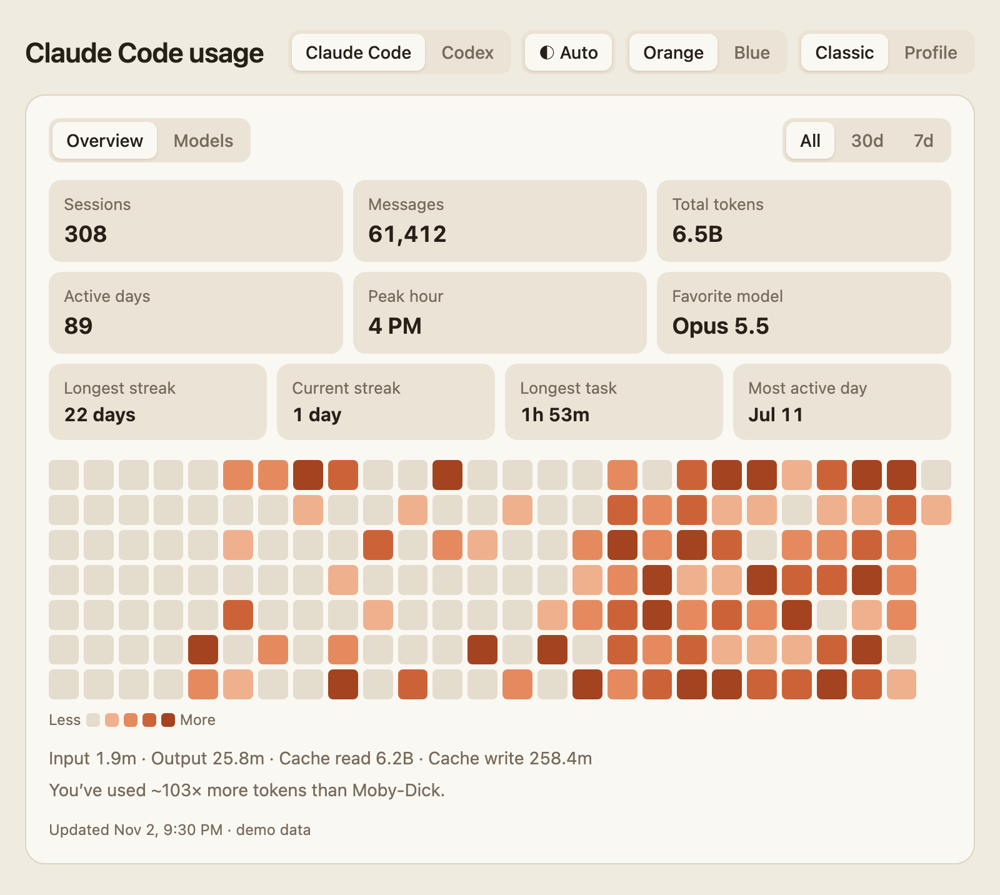
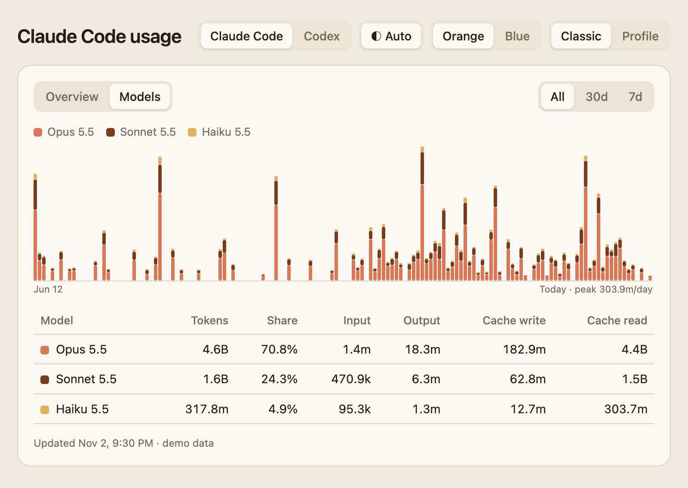
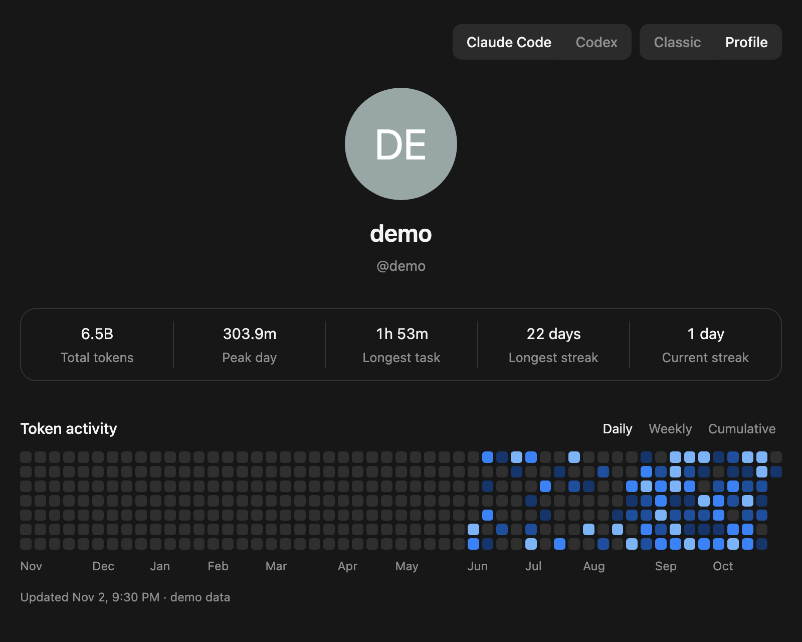

# claude-usage-page

The Claude desktop app used to show a usage card on the Code tab's new-session screen: sessions, messages, tokens, a day heatmap and a per-model breakdown. It was removed in Desktop v2.42304.0 (October 2026; see [anthropics/claude-code#102264](https://github.com/anthropics/claude-code/issues/102264)). This brings the card back as a small local web page, kept up to date in the background, with a `/my-usage` command in Claude Code to open it. It can show your local Codex usage the same way.

**[Try the live demo](https://rzhang569.github.io/claude-usage-page/)** (made-up data). Works on macOS and Windows.

Unofficial; not affiliated with Anthropic or OpenAI.





*Screenshots use made-up data.*

## What it shows

- **Overview**: sessions, messages, total tokens, active days, peak hour, favorite model, longest and current streak, longest task, most active day, a 26-week heatmap and the input / output / cache split.
- **Models**: tokens per day stacked by model, and a table with each model's share and token types.
- **Classic and Profile**: the card above, or a profile page with five totals and a year of daily, weekly or cumulative tokens. Profile follows your browser's language.
- All / 30d / 7d ranges. Hover anything for exact values. Streaks and the heatmap always cover your whole history.
- **Longest task** runs from a message you send to the end of the reply. A gap over 30 minutes ends it, so a sleeping computer doesn't count.
- Pick an orange or a blue color theme (Classic only).

When the numbers update:

- **`/my-usage`** always rebuilds first, then opens the page, so you see the latest numbers right away.
- **Opening or reloading the page yourself** rebuilds it if the last build is over a minute old, which usually takes about a second. Within that minute you see the last build.
- **A page left open** reloads itself every 10 minutes, following the same one-minute rule.
- **With no page open**, a background job rebuilds every hour.

Only the new part of each transcript is read, so long sessions stay fast.

## Where the numbers come from

Everything is read locally and nothing leaves your computer.

### Claude Code

- History comes from `~/.claude/stats-cache.json`, the file behind `claude /stats`. It keeps totals for days whose transcripts Claude Code has since cleaned up, so long-time users don't lose their early months.
- Days after that file was last written come from the transcripts in `~/.claude/projects/`, counting each API response once.
- A parse cache keeps what it has seen, so transcripts deleted later by Claude Code's cleanup still count.

Totals land within a few percent of `claude /stats`. Two known differences: `stats-cache.json` splits days in UTC, so those older days change at UTC midnight while newer days use your local time; and older days only kept per-model totals, so their input / output / cache split is estimated from each model's overall mix (marked with ≈).

### Codex

A switch at the top shows Codex in the same views. OpenAI's own Codex page adds up all your devices in the cloud; this one shows only what this computer holds, so the two can differ.

The page shows only the tools with history on this computer, so with just one of them there is no switch. A tool you add later appears at the next rebuild, and one whose folder (`~/.claude`, or `~/.codex` / `CODEX_HOME`) you delete disappears; its history stays in the parse cache and returns if the folder does.

- Days, models and tasks come from `~/.codex/sessions/`, counting each API response once. Only token counts and timestamps are kept, never what was said.
- Days are split in UTC, like OpenAI's page, so the Codex view can show a different date from the Claude Code one in the evening. Automatic approval reviews are left out too.
- **Longest task** uses the run time Codex records for each task, the same figure as its profile page. It can be shorter than the time between start and finish, and it isn't measured the same way as Claude Code's.
- Threads whose session files Codex has compressed, or that have no token rows, come from Codex's state database. They only have a total, so it is shared over the active days in the thread's life and its input / output / cache split is estimated (marked with ≈).

## Install

Needs Python 3, and Claude Code, Codex or both.

### macOS

```bash
git clone https://github.com/rzhang569/claude-usage-page.git
cd claude-usage-page
./install.sh
```

Then open <http://127.0.0.1:8788/>, or type `/my-usage` in Claude Code. Use another port with `PORT=8790 ./install.sh`.

The installer copies the scripts to `~/.claude-usage-page/`, adds two launchd jobs (rebuild every hour; serve the page on 127.0.0.1 only, which serves the page and nothing else) and writes the skill to `~/.claude/skills/my-usage/`. Run it again after pulling to update.

Uninstall with `./uninstall.sh`: it removes the launchd jobs, `~/.claude-usage-page/` and both skills. This also deletes the parse cache (`cache.json`), which holds history for transcripts Claude Code has since cleaned up and can't be rebuilt. To keep it, copy the file out before uninstalling, copy it back after reinstalling, then run `python3 build.py` in that folder.

### Windows

Install Python 3 from [python.org](https://www.python.org/downloads/) first (the Microsoft Store stub won't do). Then, in PowerShell:

```powershell
git clone https://github.com/rzhang569/claude-usage-page.git
cd claude-usage-page
powershell -ExecutionPolicy Bypass -File install.ps1
```

Then open <http://127.0.0.1:8788/>, or type `/my-usage` in Claude Code. Use another port with `-Port 8790`. No admin rights needed.

The installer copies the scripts to `%USERPROFILE%\.claude-usage-page\`, adds two Task Scheduler tasks (`claude-usage-page-build` every hour, `claude-usage-page-serve` at sign-in; both run without a console window) and writes the skill to `%USERPROFILE%\.claude\skills\my-usage\`. Run it again after pulling to update.

Uninstall with `powershell -ExecutionPolicy Bypass -File uninstall.ps1`: it removes both tasks, `%USERPROFILE%\.claude-usage-page\` and both skills. This also deletes the parse cache (`cache.json`), which holds history for transcripts Claude Code has since cleaned up and can't be rebuilt. To keep it, copy the file out before uninstalling, copy it back after reinstalling, then run `python build.py` in that folder.

Claude Code's and Codex's own files are never touched on either system; only the two skills are added.

The installer also adds `$my-usage` to Codex, which replies with a link that opens the Codex view beside the chat. Both commands are added even if one of the tools isn't installed yet, so they're there when it is.

`/my-usage` shows up only in sessions started after the install: Claude Code reads its skill list when a session starts, so sessions that were already open won't list it. Start a new session, or restart Claude to make it appear in existing ones.

### Other systems

`build.py` and `serve.py` are plain Python with no dependencies. Run `python3 build.py` on a timer (cron, a systemd timer) and `python3 serve.py` at login, or just open the generated `index.html` in a browser. Set `CLAUDE_CONFIG_DIR` if your Claude Code data isn't in `~/.claude`.

## Tests

Run the standard-library-only test suite from the repository root:

```bash
python3 -m unittest -v
```

Tests generate fake Claude and Codex data and application copies in temporary directories, set `CLAUDE_CONFIG_DIR` and `CODEX_HOME` there, and start server subprocesses on free localhost ports. They do not use or modify your real data or installed usage page. The tests of the page's own script need Node and are skipped without it.

## License

MIT
