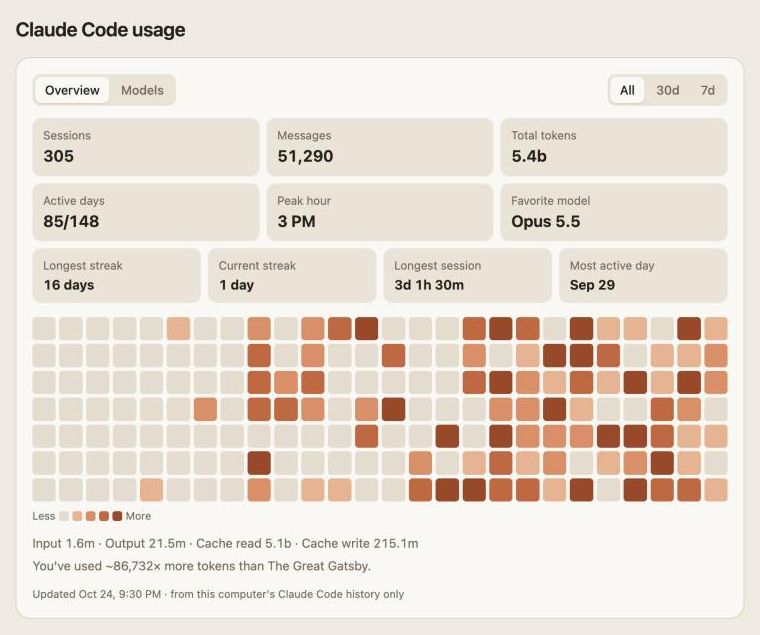
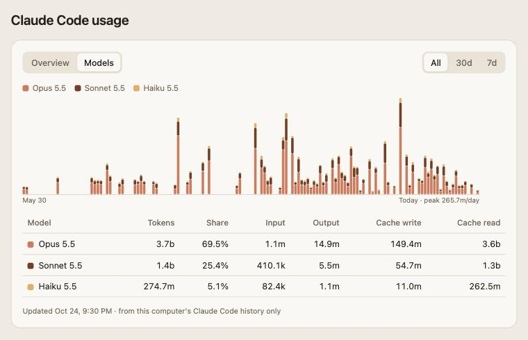

# claude-usage-page

The Claude desktop app used to show a usage card on the Code tab's new-session screen: sessions, messages, tokens, a day heatmap and a per-model breakdown. It was removed in Desktop v2.42304.0 (October 2026; see [anthropics/claude-code#102264](https://github.com/anthropics/claude-code/issues/102264)). This brings the card back as a small local web page, kept up to date in the background, with a `/my-usage` command in Claude Code to open it.

Unofficial; not affiliated with Anthropic.




*Screenshots use made-up data.*

## What it shows

- **Overview**: sessions, messages, total tokens, active days, peak hour, favorite model, longest and current streak, longest session, most active day, a 26-week heatmap and the input / output / cache split.
- **Models**: tokens per day stacked by model, and a table with each model's share and token types.
- All / 30d / 7d ranges. Hover anything for exact values.

## Where the numbers come from

Everything is read locally and nothing leaves your computer.

- History comes from `~/.claude/stats-cache.json`, the file behind `claude /stats`. It keeps totals for days whose transcripts Claude Code has since cleaned up, so long-time users don't lose their early months.
- Days after that file was last written come from the transcripts in `~/.claude/projects/`, counting each API response once.
- A parse cache keeps what it has seen, so transcripts deleted later by Claude Code's cleanup still count.

Totals land within a few percent of `claude /stats`. Two known differences: `stats-cache.json` splits days in UTC, so those older days change at UTC midnight while newer days use your local time; and older days only kept per-model totals, so their input / output / cache split is estimated from each model's overall mix (marked with ≈).

## Install

Needs Python 3 and Claude Code.

### macOS

```bash
git clone https://github.com/rzhang569/claude-usage-page.git
cd claude-usage-page
./install.sh
```

Then open <http://127.0.0.1:8788/>, or type `/my-usage` in Claude Code (in a new session). Use another port with `PORT=8790 ./install.sh`.

The installer copies the scripts to `~/.claude-usage-page/`, adds two launchd jobs (rebuild every hour; serve the page on 127.0.0.1 only, which serves the page and nothing else) and writes the skill to `~/.claude/skills/my-usage/`. Run it again after pulling to update.

Uninstall with `./uninstall.sh`: it removes the launchd jobs, `~/.claude-usage-page/` and the skill.

### Windows

Install Python 3 from [python.org](https://www.python.org/downloads/) first (the Microsoft Store stub won't do). Then, in PowerShell:

```powershell
git clone https://github.com/rzhang569/claude-usage-page.git
cd claude-usage-page
powershell -ExecutionPolicy Bypass -File install.ps1
```

Then open <http://127.0.0.1:8788/>, or type `/my-usage` in Claude Code (in a new session). Use another port with `-Port 8790`. No admin rights needed.

The installer copies the scripts to `%USERPROFILE%\.claude-usage-page\`, adds two Task Scheduler tasks (`claude-usage-page-build` every hour, `claude-usage-page-serve` at sign-in; both run without a console window) and writes the skill to `%USERPROFILE%\.claude\skills\my-usage\`. Run it again after pulling to update.

Uninstall with `powershell -ExecutionPolicy Bypass -File uninstall.ps1`: it removes both tasks, `%USERPROFILE%\.claude-usage-page\` and the skill.

Claude Code's own files are never touched on either system.

### Other systems

`build.py` and `serve.py` are plain Python with no dependencies. Run `python3 build.py` on a timer (cron, a systemd timer) and `python3 serve.py` at login, or just open the generated `index.html` in a browser. Set `CLAUDE_CONFIG_DIR` if your Claude Code data isn't in `~/.claude`.

## License

MIT
